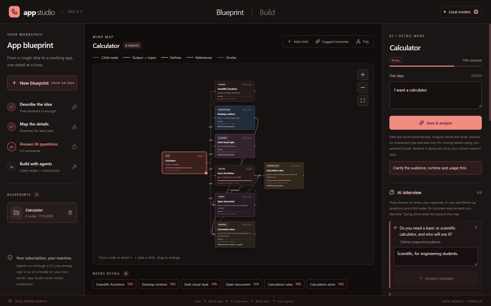
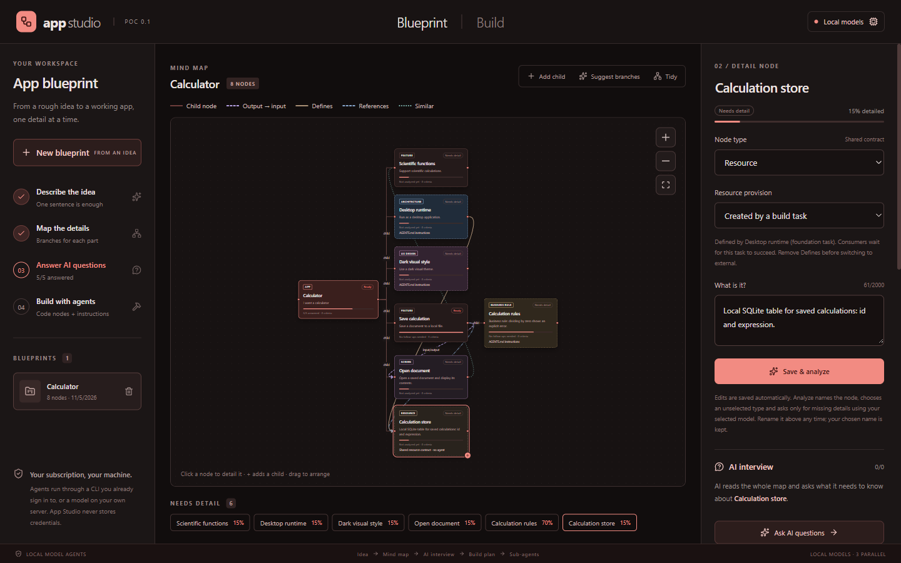
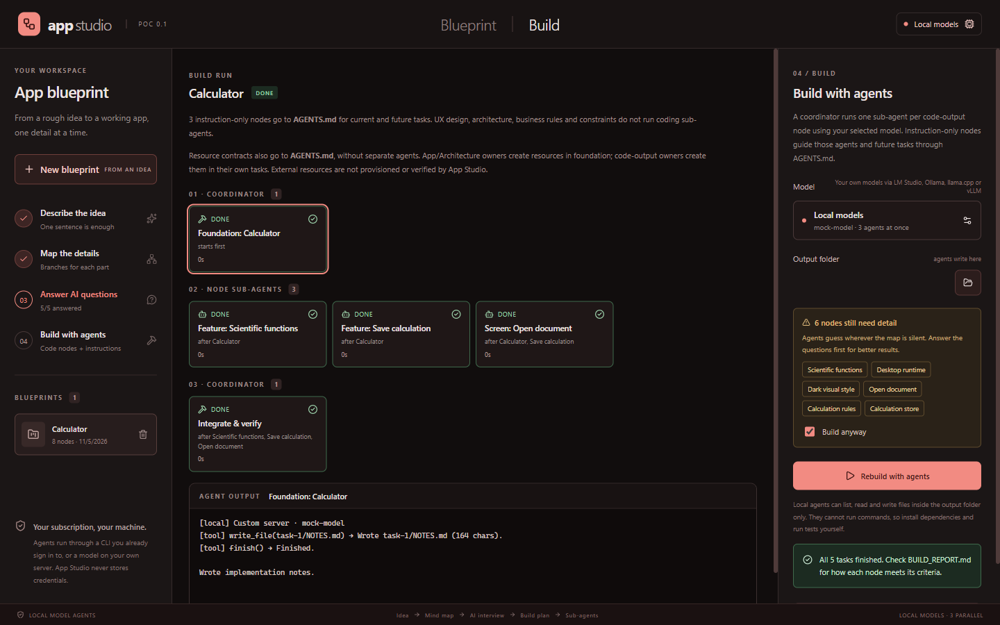
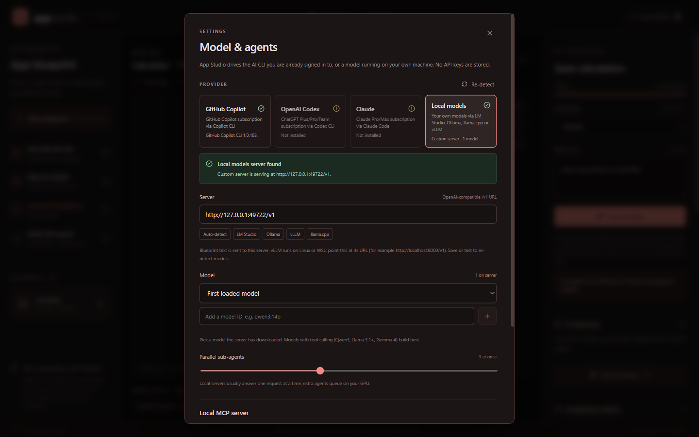
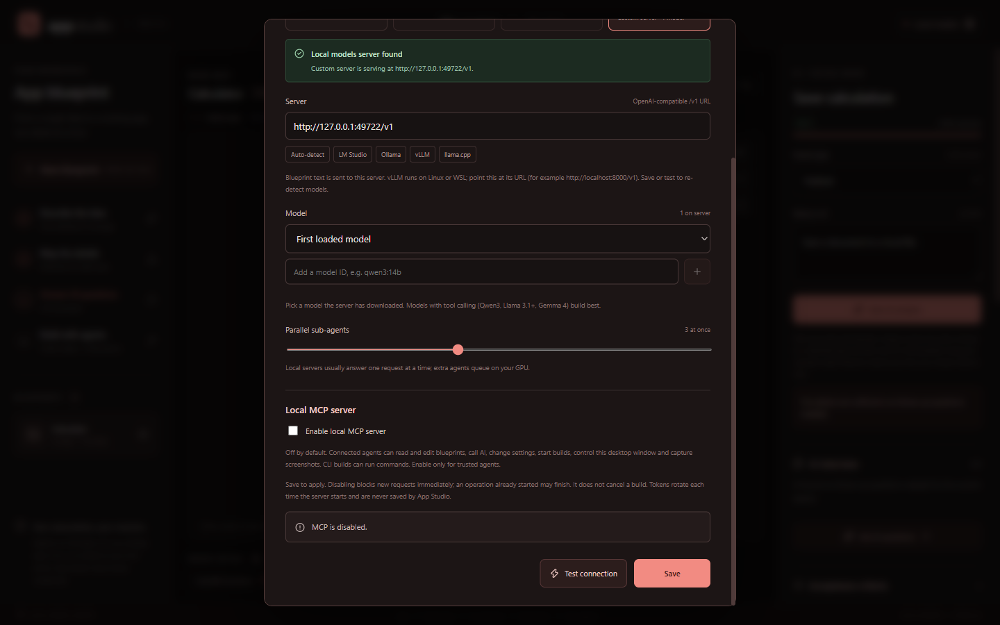

# App Studio

App Studio is an AI-powered, no-code app builder that works from a **mind map**. You describe an idea, shape it into features, screens, data, integrations, shared resources, UX design, architecture, business rules and constraints, and answer AI questions about the details. A coordinator runs **one sub-agent per code-output node**; instruction-only nodes and resource contracts go into **AGENTS.md** for current and future tasks.

> **Status:** proof of concept (v0.1). The full idea → map → interview → multi-agent build loop works end to end. Verification loops, re-planning, deployment and merge-conflict handling between agents are goals, not shipped features.



## How it works

1. **Describe the idea.** **Start blueprint** saves the root `App` node and analyzes it automatically. AI gives it a short name and asks idea-specific questions about scope, target audience, runtime, how people will use it, and look and feel. For "I want a calculator," this could mean basic versus scientific, desktop versus web/mobile, and visual style—not a generic checklist.
2. **Save and analyze nodes.** Use **Add child**, enter the details, then **Save & analyze**. Leave **Node type** on **Auto-detect** for AI to classify it, or select a type yourself. AI names the node and adds zero to five follow-up questions only when needed. Rename the title at any time; future analysis preserves your chosen name and type. Naming and analysis use the selected provider/model, including **Local models**, not a separate service.
3. **Submit answers to expand the map.** Each question has an **Answer** button. It saves the response and uses the whole blueprint to ask relevant follow-ups and, when warranted, automatically create child nodes for concrete requirements in that answer. For example, "scientific calculator on desktop with a dark theme" can produce a feature, an architecture instruction, and a UX instruction. Typing alone never expands the map. Added nodes remain editable and removable. **Suggest branches** still offers a separate tray you explicitly accept.
4. **Connect related details.** In **Connections**, **Child of** controls the hierarchy; **Depends on (input from)** links a producer to its consumer (Save document → Open document); **Defines** assigns a resource's creator; **References** connects a consumer to that resource; **Similar to** shares patterns without imposing build order. The map uses labeled, directed links with distinct line styles. Duplicate, dangling, self-referential and cyclic dependencies, including cycles derived from resource ownership, are rejected.
5. **Review and build.** Answers and acceptance criteria form each node's spec; **Needs detail** surfaces gaps. A current analysis with no follow-up questions counts as reviewed, but non-root nodes still need acceptance criteria. **Draft with AI** works from answered questions or analyzed details. The root App node's foundation task includes system instructions to initialize a Git repository in the output folder, scaffold the app and write `APP_STUDIO.md`. Code-output sub-agents follow explicit dependencies, and an integration agent writes `BUILD_REPORT.md`.

The foundation instructions cover dependency manifests, runtime/build configuration, entry points, shared and per-node code folders, development/build/test scripts, and a stack-appropriate `.gitignore`. The stack follows the blueprint's architecture decisions (defaulting to Vite + React + TypeScript for a web app). Agents are instructed to preserve existing scaffolding and Git history, leave parent repositories untouched, and not create commits, configure Git identity, add remotes or push. With **Local models**, scaffolding is written through file tools; Git initialization is documented as a pending manual `git init` step in the generated `README.md`, not reported as completed.

Edits auto-save even before analysis. If AI analysis or answer review fails, the saved text is kept, an error is shown, and the same button retries. Analysis does not invent a successful result when the provider is unavailable.

**Tidy** arranges the map left to right with space between cards and nested branches, accounting for rendered card sizes, including taller instruction-only cards and wrapped titles. The MCP `map_tidy` tool uses the same layout and saves the arranged positions.

The map's top-right zoom in, zoom out and fit view controls are individually bordered buttons with space between them and visible keyboard focus.

### Node types and durable instructions

| Node types | Output |
| --- | --- |
| Feature, Screen, Data, Integration | Code, through a dedicated sub-agent |
| Resource | A shared contract in `AGENTS.md` and `BLUEPRINT.md`; created by its Defines owner, or externally provided; no separate agent |
| UX design, Architecture, Business rule, Constraint | Instructions in `AGENTS.md`, with node scope, details, answers, unresolved questions and acceptance criteria |

Each type has a distinct color shade and a text label. Instruction-only cards also show **AGENTS.md instructions** and a dashed border; they are not reported as coding-agent work.

Before each build, App Studio writes or refreshes a marked section in the output project's `AGENTS.md`. User-authored instructions outside that section are preserved. Agents are told to read it along with `APP_STUDIO.md`, so tooling, design and business decisions guide the foundation and later tasks. Editing the blueprint refreshes those instructions on the next build. Instruction-only nodes do not get a coding sub-agent or participate in code input/output dependencies; use hierarchy and similarity to describe their scope.

Explicit producer/consumer dependencies and dependencies derived from resources take priority over default data-first and parent-first ordering. Similarity links appear in the shared specification but do not add scheduling dependencies. Existing saved blueprints retain their node types, names and connections; legacy blueprints without connections load with an empty list.

### Shared resources: Defines and References

Select **Resource** as the **Node type** for a shared table, file/directory, API, queue, compute resource or output artifact. Describe its contract in the details, answers and acceptance criteria: schema, location, lifecycle, access rules and expected outputs. A Resource describes *what is shared*; a Data or other code-output node describes *the work that creates it*. Performance budgets and networking policies remain Constraint nodes rather than new resource types.

For example:

| From | Relationship | Resource |
| --- | --- | --- |
| Storage setup (Data or Feature) | Defines | `foobar` table |
| Save a record (Feature) | References | `foobar` table |
| Show records (Screen) | References | `foobar` table |

Both consumers wait for **Storage setup** to succeed. They receive the resource's shared contract and the successful defining task's recent output, and are instructed to inspect and reuse its implementation rather than recreate it. The owner is instructed to report implementation paths, schema and access methods. Multiple references to resources from the same owner produce only one task dependency; an owner may reference its own resource.

**App** and **Architecture** nodes can also **Define** resources: the **foundation task** implements those definitions before any node agents start. References from instruction-only nodes also apply to foundation; a reference that would require foundation to wait for a later agent is rejected as a cycle. Other instruction-only kinds cannot own resources.

From a resource's inspector, the inverse controls are labelled **Defined by** and **Referenced by**. Connections use stable node IDs, so renaming either endpoint preserves ownership and ordering. Each managed resource needs exactly one Defines owner. An unfinished resource can be saved without an owner, but builds are blocked—even with **Build anyway**—until ownership is assigned. Removing an owner removes its links and makes the remaining resource an ownership blocker again.

For an existing resource outside the generated project, set **Resource provision** to **Externally provided**. It has no Defines owner and no creation task; remove any Defines link before switching. App Studio does not provision or verify external infrastructure. Resource nodes are not marked **Built**; build status belongs to their owning tasks. A failed, cancelled or skipped owner blocks its consumers. Editing resource contracts, their owners/consumers or Defines/References links invalidates previous node-level built claims; the last build run remains a historical record until rebuilt. Moving cards does not invalidate build status.

Ownership coordinates agent work, not runtime availability verification. An agent may generate migration/setup code without executing it, especially with Local models. Such pending setup must be reported rather than treated as a provisioned resource.





Live logs, failures, skipped and cancelled tasks are shown honestly. A node is marked **Built** only when its agent succeeded.

## Model providers

App Studio never stores API keys. Open **Model & agents** (the chip at the top right) to choose a provider and a model you supply:

| Provider | What it uses | Setup |
| --- | --- | --- |
| **GitHub Copilot** | Your Copilot subscription via the [Copilot CLI](https://github.com/github/copilot-cli) | Install the CLI and sign in (`copilot`, then `/login`). Model IDs such as `auto`, `claude-sonnet-5.5` or `gpt-6.1-sol` are passed to `--model`. |
| **OpenAI Codex** | ChatGPT Plus/Pro/Team via the Codex CLI | `npm i -g @openai/codex`, then `codex login`. |
| **Claude** | Claude Pro/Max via Claude Code | Install Claude Code, then run `claude` and sign in. |
| **Local models** | Any OpenAI-compatible `/v1` server on your machine or network | See below. |



Prompts are sent to CLIs on stdin only, never as command-line arguments. Naming, analysis, answer review, interview and suggestion calls run without tools; only build agents get write access, and only inside the chosen output folder.

### Local models

**Local models** talks to any server that implements the OpenAI chat-completions API. With **Auto-detect** it probes these on `127.0.0.1`:

| Server | Default URL | Start it with |
| --- | --- | --- |
| [LM Studio](https://lmstudio.ai) | `http://127.0.0.1:1234/v1` | `lms server start` (models load on first request) |
| [Ollama](https://ollama.com) | `http://127.0.0.1:11434/v1` | `ollama serve`, then `ollama pull qwen3:14b` |
| [vLLM](https://docs.vllm.ai) | `http://127.0.0.1:8000/v1` | `vllm serve <model>` on Linux or WSL2 (vLLM does not run natively on Windows) |
| [llama.cpp](https://github.com/ggml-org/llama.cpp) | `http://127.0.0.1:8080/v1` | `llama-server -m model.gguf --jinja` |

You can also enter a custom URL (for example a vLLM box on your network). Blueprint text is sent to whichever server you choose. ComfyUI is not supported here because it serves image/diffusion workflows, not chat models.

Pick a served model in **Model**, or leave **First loaded model**. Models with tool calling (Qwen3, Llama 3.1+, Gemma 4, gpt-oss) build best. Local build agents get a sandboxed toolset — `list_files`, `read_file`, `write_file`, `finish` — confined to the output folder. If a server rejects tool calling, agents fall back to replying with `### FILE: path` blocks. **Local agents cannot run commands**, so install dependencies and run the generated tests yourself.

## Local MCP server and desktop control

App Studio includes an MCP **server** for trusted agents to operate the running app, not just generate code. In **Model & agents**, select **Enable local MCP server** and **Save**, then reopen settings and choose **Copy MCP configuration**. Paste it into a trusted MCP client's configuration. The copied JSON uses `mcpServers.app-studio`, `type: "http"`, `url`, and an `Authorization` header; clients with a different configuration format need the same URL and header.

The server is off by default (including existing installations). It uses authenticated, stateless **Streamable HTTP** at `http://127.0.0.1:47831/mcp`. Only loopback, non-browser clients are accepted. The bearer token is generated in memory and changes whenever the server is enabled or the app restarts; copy fresh configuration after either. Never commit or share that token. Port conflicts appear as **MCP failed** in settings rather than silently falling back to another port.



| Tools | Capabilities |
| --- | --- |
| `studio_get_state` | Saved blueprints, current draft, selection/view, suggestions, completeness gaps, resource ownership problems, build plan, task status and full logs. Does not return the MCP token. |
| `blueprint_*`, `node_add/update/delete`, `connection_*`, `map_tidy` | Create/open/save/delete blueprints, edit nodes and questions/criteria, reparent nodes, edit connections and arrange the map. Resources use `kind: "resource"` and optional `resourceMode: "managed"` (default) or `"external"`. Defines/References connections point from the owner/consumer's `sourceId` to the resource's `targetId`. |
| `node_analyze`, `node_interview`, `question_answer`, `branches_*`, `acceptance_draft` | The same AI workflows and persisted results as the UI, including Answer-driven expansion and explicitly accepted branch suggestions. |
| `settings_update`, `providers_refresh`, `provider_test`, `mcp_copy_config` | Provider/model/settings management, actual provider detection/testing, MCP disable, and copying connection configuration to the local clipboard on request. |
| `build_set_output/start/cancel/reveal` | Choose an absolute output path without a dialog, build/rebuild, stop and open the output folder. Missing detail requires explicit `allowGaps: true`, equivalent to **Build anyway**. Missing resource ownership always blocks building. |
| `desktop_set_view`, `desktop_scroll`, `map_viewport`, `desktop_window`, `desktop_screenshot`, `desktop_dismiss_error` | Switch tabs, select nodes or task logs, open/close settings, scroll panels, pan/zoom/fit the map, focus/minimize/maximize/restore/resize the window, capture it and dismiss errors. |

Read `studio_get_state` first and use `blueprint_open` to choose the active blueprint. Tools share the desktop's handlers, so edits appear on screen and persist. `blueprint_save` requires the saved `updatedAt` as `expectedUpdatedAt` to prevent stale replacement; prefer targeted node tools. AI failures remain errors, while already-saved text is retained. The state includes the live draft so an agent can account for unsaved user edits. Workflow tools reject requests while another operation is busy or the settings dialog is open; state polling remains available during AI work. Close settings before changing them through a tool; discarding edited settings requires an explicit flag. Large requests are limited to 8 MiB. Allow up to ten minutes for an AI tool call, and inspect state before retrying a timed-out mutation.

**Access implications:** a connected agent can read private blueprint text, paths and logs, delete blueprints, change provider/CLI paths, take screenshots and start builds. CLI builds can execute commands inside their output folder using the user's existing CLI session. Grant access only to trusted clients and authorize their actions deliberately. No arbitrary JavaScript evaluation, generic shell tool or OS-wide input is exposed.

To stop access, uncheck **Enable local MCP server** and save. New requests are rejected immediately; already-started operations may finish. Disable does **not** cancel a build: use **Stop** or `build_cancel` separately. The listener shuts down with the app. A client that disables its own connection must use the desktop setting to re-enable it.

This does not add outbound MCP support to the built-in local-model agent, which still has its four sandboxed file tools, or manage external MCP servers for provider CLIs.

## Getting started

Requires Node.js 22+ on Windows, macOS or Linux.

```powershell
npm install
npm run dev
```

If npm's script policy blocked Electron's postinstall (you'll see "Electron failed to install correctly"), run `node node_modules\electron\install.js` once.

Build output goes to `Documents\App Studio\<blueprint name>` by default; choose another folder from the **Build** tab. After the first build, that folder is retained even if the blueprint is renamed, so its code and `AGENTS.md` stay together.

## Validation

```powershell
npm test          # analysis, prompts, connections, instructions, planning, process safety and local-agent builds
npm run typecheck
npm run build
npm run smoke     # launches the built app hidden, drives the full flow, refreshes docs/screenshots
npm run smoke:mcp # real MCP client against an isolated desktop with mock AI
```

Tests and the smoke run use `tests/fixtures/mock-openai.mjs`, a small OpenAI-compatible server, so they need no model or subscription. The desktop smoke covers the calculator interview, Answer-triggered expansion, automatic naming with manual overrides, type detection, resource ownership and references, failure/retry persistence, instruction-only output and a full build. Resource tests cover dependency cycles, foundation ownership, external resources, creator handoffs and consumer blocking after failure/cancellation. The MCP smoke exercises real discovery, typed resource edits, persisted desktop outcomes and derived build ordering. Mock results verify the workflow, not real-model question quality or actual database provisioning.

## Limitations

- Proof of concept: no verification loop or re-planning after a failed agent; failed tasks block their dependants.
- Parallel sub-agents share one output folder and are told to stay in their node's folder; conflicting edits to shared files are possible.
- Local agents have no shell, so they cannot install packages or run tests.
- The Copilot CLI flow has been verified with a real subscription. The Codex and Claude Code flags follow their documentation but have not yet been verified on a real install.
- Local servers usually process one request at a time, so extra parallel agents queue on your GPU.

## Project guidance

See [AGENTS.md](AGENTS.md) for architecture, the red design system and UX principles. The `design` and `ux` custom agents in [.github/agents](.github/agents) apply them when reviewing UI changes.
